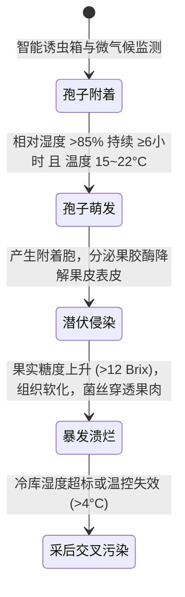

# 蓝莓全周期农艺机理、病虫害动力学与生理生长模型全书
# (Blueberry Comprehensive Agronomy, Pest Dynamics & Growth Physiology Models)

> **版本：** 7.0.0 · 农业工业级知识库专题  
> **适用产区基准：** 云南澄江抚仙湖北岸（北纬 24.67°N，东经 102.91°E，海拔 1,750 米）900 亩设施无土基质栽培蓝莓超级工厂。  
> **数据权威来源：** 国家蓝莓产业技术体系、中国农业科学院设施农业研究所、国家食品安全国家标准 GB 2763-2021、国际园艺学会 (ISHS) 蓝莓生理生化研究标准。

---

## 一、 蓝莓物候周期与生理生长动力学 (Phenological Growth Stages)

在云南澄江低纬高原干热湖盆微气候下，由于年日照充足（>2,250 小时）且冬春基本无霜，采用促早覆膜与双层内遮阳控温技术，蓝莓物候期显著早于北方与沿海产区，实现每年 11 月至次年 5 月的超长鲜果采收期。

```
┌────────────────────────────────────────────────────────────────────────────────────────┐
│ 蓝莓物候周期七步演进 (Phenological Stage Pipeline)                                      │
│                                                                                        │
│ [阶段 1: 休眠蓄冷] ➔ [阶段 2: 萌芽膨大] ➔ [阶段 3: 开花授粉] ➔ [阶段 4: 幼果膨大]        │
│  (6月-8月轻修剪)     (9月花芽分化膨大)    (10月-11月开花)      (11月-12月果实膨大)    │
│                                                                                        │
│ ➔ [阶段 5: 转色成熟] ➔ [阶段 6: 采收盛期 (本案基准)] ➔ [阶段 7: 采后复壮与花芽分化]     │
│   (12月-次年1月硬核)    (1月-5月梯次采收 · 重点保护果粉)   (5月-6月重剪与养分储备)       │
└────────────────────────────────────────────────────────────────────────────────────────┘
```

### 1.1 核心主栽品种生物学特性参数库
| 品种名 | 类型 | 需冷量 (Chilling Hours) | 单果重与果径 (Grade A 占比) | 糖酸比 (Brix / TA) | 果粉特性 (Bloom) | 商业定位 |
|---|---|---|---|---|---|---|
| **优瑞卡 (Eureka)** *(本案南区核心)* | 南高丛特早熟旗舰 | 100~150 小时 (<7.2°C) | 2.8~4.5g / 18~24mm (特级果率 ≥82%) | Brix 13.5~15.5% / TA 0.65% | 极厚、雪白、抗摩擦脱落 | 高端商超直供 (盒马/山姆 SLA 特级鲜果) |
| **绿宝石 (Emerald)** | 南高丛中早熟主力 | 200~250 小时 | 2.5~3.8g / 16~20mm (特级果率 ≥75%) | Brix 12.8~14.2% / TA 0.72% | 中等均匀，硬度极高 | 全国一级果品批发市场流通基本盘 |
| **天后 (Diva)** | 南高丛高香极早熟 | 80~120 小时 | 3.0~5.0g / 20~26mm (Jumbo 级率 ≥60%) | Brix 14.5~16.8% / TA 0.58% | 致密银白，花萼微凹 | 私域高端礼盒与空运冷链现货 (¥120/kg) |

---

## 二、 全基质无土栽培水肥动力学模型 (Substrate Fertigation Models)

900 亩园区 100% 采用专业加仑容器（35L/盆）无土基质栽培，基质配比为 **60% 进口粗纤维椰糠 + 20% 泥炭土 + 20% 膨胀珍珠岩**，透气孔隙度（Air-Filled Porosity）保持在 25%~30%，气水比（Air-Water Ratio）为 1:2.5。

```
┌────────────────────────────────────────────────────────────────────────────────────────┐
│ 基质微环境三大平衡控制环 (Substrate Equilibrium Loop)                                  │
│                                                                                        │
│ 1. 酸碱度平衡 (pH Control): 严禁高于 5.5 (4.8~5.2 黄金区间，防止铁/锌微量元素沉淀吸收障碍)│
│ 2. 盐分电导平衡 (EC Balance): 随物候期阶梯调整 (灌溉液 EC 1.2~1.8 mS/cm，回液 EC ≤2.5)│
│ 3. 脉冲微灌水动力学 (Pulse Fertigation): 每日 6~12 次微脉冲，单次 100~180ml，排液率 15~20%│
└────────────────────────────────────────────────────────────────────────────────────────┘
```

### 2.1 蓝莓各生育阶段水肥配比与靶标模型表
| 物候阶段 | 灌溉液 pH 靶标 | 滴灌 EC (mS/cm) | 氮磷钾配比 (N-P₂O₅-K₂O) | 关键中微量元素强化 | 自动微灌触发阈值 |
|---|---|---|---|---|---|
| **花芽萌发期** | 4.8 ~ 5.0 | 1.1 ~ 1.3 | 20 - 10 - 20 (高硝态氮) | 硼 (B) 0.5 ppm，促花粉萌发 | 基质含水率 < 35% |
| **盛花授粉期** | 4.9 ~ 5.1 | 1.2 ~ 1.4 | 15 - 15 - 15 (均衡型) | 钙 (Ca) 2.5 ppm，防花萎凋 | 基质含水率 < 32% |
| **幼果膨大期** | 4.8 ~ 5.0 | 1.4 ~ 1.7 | 12 - 8 - 24 (高钾高钙) | 螯合钙 (EDTA-Ca) 4.0 ppm 促细胞壁致密 | 基质含水率 < 30% |
| **转色采收期** *(当前)* | 5.0 ~ 5.2 | 1.3 ~ 1.6 | 10 - 5 - 28 (超高钾) | 镁 (Mg) 1.5 ppm + 铁 (EDDHA-Fe) 2.0 ppm | **基质含水率 < 28%** (微亏缺灌溉增糖) |

---

## 三、 微气候物理模型与环境调控机理 (Microclimate Physics Models)

设施温室环境调控的核心是维持作物的**最佳饱和蒸气压差 (VPD, Vapor Pressure Deficit)** 与光合有效辐射 (PAR)。

### 3.1 蓝莓叶片饱和水汽压差 (VPD) 动力学公式
$$\text{VPD} = \text{VPsat} \times (1 - \frac{\text{RH}}{100})$$
$$\text{VPsat} = 0.61078 \times \exp\left(\frac{17.27 \times T}{T + 237.3}\right) \quad (\text{kPa})$$

*   **蓝莓最佳气孔导度 VPD 区间：** **0.8 ~ 1.2 kPa**。
*   **低 VPD 风险区 (<0.5 kPa，高湿无风)：** 叶片蒸腾受阻，根系钙离子无法随蒸腾流向果实运输，极易诱发果肉软化及**灰霉病菌 (Botrytis cinerea)** 孢子萌发。
*   **高 VPD 风险区 (>1.8 kPa，干热强光)：** 气孔被迫关闭，光合作用停滞，果皮水分被倒吸，极易发生日灼与裂果。

---

## 四、 蓝莓两大毁灭性病害侵染动力学机理 (Disease Dynamics)

### 4.1 灰霉病 (Botrytis cinerea) 潜伏侵染动力学模型 (BIM 模型)
灰霉病是采前与采后蓝莓软化腐烂的“头号杀手”。病菌常在花期侵入花瓣花柱潜伏，在果实接近成熟或采后高湿环境下爆发。



*   **病害发生指数计算公式 (Botrytis Risk Score 0~100)：**
    $$\text{Risk}_{\text{Botrytis}} = 100 \times \left[ 0.4 \times f(T) + 0.4 \times g(\text{RH}, t) + 0.2 \times \text{TrapScore} \right]$$
    *当温室内温度在 18~24°C、空气湿度持续 >85% 超过 8 小时且诱虫板/测报箱检出孢子时，风险值即突破 >60 警戒线（如本案实测 68/100）。*

### 4.2 炭疽病 (Colletotrichum acutatum)
*   **高发条件：** 连续高温（28~32°C）配合高湿喷淋降温（水滴透镜效应）。
*   **症状与防控：** 果实表面出现凹陷圆形粉红色胶质孢子团。全园严禁在阳光强烈的午间对树冠弥雾喷水！

---

## 五、 蓝莓三大主要虫害发生规律与智能测报模型 (Pest Dynamics)

### 5.1 西花蓟马 (Frankliniella occidentalis) —— 重点预警对象
西花蓟马体积极小（0.9~1.4mm），具有强趋黄性，吸食幼果果皮花青素与果粉，导致成熟果实木栓化生疤。
*   **有效积温发育模型：**
    $$K = N \times (T - T_0)$$
    *发育起点温度 $T_0 = 9.8^\circ\text{C}$，全世代有效积温 $K = 252$ 日·度。澄江春季日均温 18.5°C 时，仅需 28 天即可完成一代繁殖！*
*   **测报阈值与经济危害水平 (EIL)：**
    *   智能黄色微距诱虫板捕获量 **< 5 头/板/天**：安全萌芽期，AI 自主派发巡查，绝对严禁用药；
    *   捕获量 **5 ~ 10 头/板/天**：轻度发生，释放捕食螨（加州新小绥螨）生物防控；
    *   捕获量 **> 12 头/板/天 (如本案 14.8 头)**：突破经济危害阈值，必须启动针对性隔离或紧急抢收！

### 5.2 斑翅果蝇 (Drosophila suzukii)
产卵于成熟变软的果实内，孵化出的幼虫导致果实内部化水烂果。必须保持采后预冷并在防虫网（60目）阻隔下作业。

---

## 六、 农药残留限量 (GB 2763-2021) 与安全采收间隔期 (PHI) 数据库

国家标准 GB 2763-2021 对蓝莓特级果出口与商超准入设定了严苛的农残最大残留限量 (MRL)。

| 药剂通用名称 | 药剂类别 | 防治对象 | 适用安全间隔期 (PHI) | GB 2763 最大残留限量 (MRL) | 本案适用性与门禁判定 |
|---|---|---|---|---|---|
| **代森锰锌 (Mancozeb)** | 传统化学广谱杀菌剂 | 灰霉病、炭疽病 | **14 ~ 21 天** | 2.0 mg/kg | ❌ **严重违规拦截**：距交货仅剩 3 天，喷施抽检必超标，合规门禁一票否决！ |
| **咯菌腈 (Fludioxonil)** | 化学保护性杀菌剂 | 灰霉病 | **7 ~ 10 天** | 3.0 mg/kg | ❌ **违规拦截**：安全期超出 3 天采收窗口。 |
| **哈茨木霉菌 (Trichoderma harzianum)** | **纯天然生防微生物制剂** | 灰霉病菌丝竞争拮抗 | **0 天 (PHI = 0d)** | **豁免农残限量清单** | ✔ **完全合规放行**：纯生物菌剂，当天喷施当天即可采摘上市！ |
| **枯草芽孢杆菌 (Bacillus subtilis)** | 生物抑菌剂 | 细菌性及真菌性穿孔 | **0 天 (PHI = 0d)** | **豁免农残限量清单** | ✔ **合规放行**。 |
| **苦参碱 (Matrine)** | 植物源低毒杀虫剂 | 蓟马、蚜虫 | **3 天 (PHI = 3d)** | 0.5 mg/kg | ✔ **严格临界合规**。 |

---

## 七、 采后生理动力学与保鲜冷链储运模型 (Post-Harvest Physiology)

蓝莓属于**呼吸跃变型浆果**，采收时已达到最佳食用风味，采后糖度不再增加，但呼吸代谢与果胶酶降解会急剧消耗养分并使果肉变软。

```
┌────────────────────────────────────────────────────────────────────────────────────────┐
│ 蓝莓采后品质三维保鲜体系 (Quality Preservation Protocol)                                │
│                                                                                        │
│ 1. 果粉完整度保护 (Bloom Protection): 蜡质主要由二十九烷与齐墩果酸构成，耐受机械摩擦阈值极低 │
│    采摘必须轻拿轻放，严禁手指直接擦拭果面；光电分选采用水冷柔性滚轴。                     │
│                                                                                        │
│ 2. 差压快速预冷 (Forced-Air Pre-Cooling): 采后 2 小时内必须将果心温度从 25°C 强制压至 2°C │
│    每延迟 1 小时预冷，蓝莓货架期缩短 1.5 天！                                          │
│                                                                                        │
│ 3. 气调贮藏参数 (Controlled Atmosphere): 0 ~ 1.5°C，相对湿度 90%~95%，CO₂ 10%~12%，O₂ 2%~3%│
│    高浓度 CO₂ 可显著抑制灰霉病菌丝生长，货架保鲜期可从 14 天延长至 45 天！             │
└────────────────────────────────────────────────────────────────────────────────────────┘
```

本知识库作为全站确定性仿真引擎、合规门禁校验与多智能体研判的底层科学支柱。