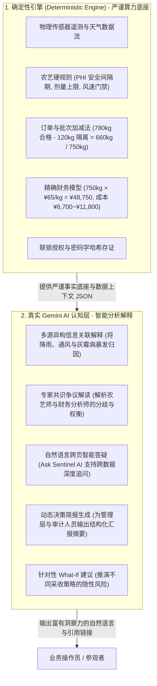
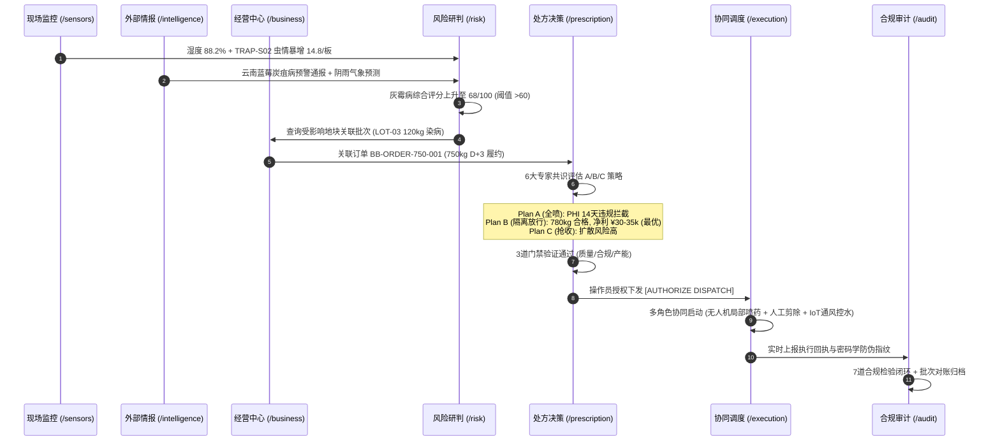
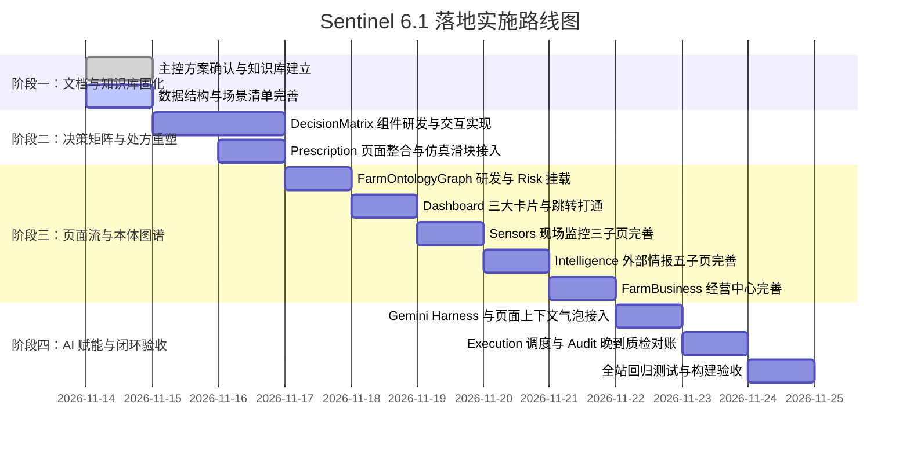

# Sentinel 6.1.0 架构升级与全站优化主控方案（纯蓝莓工业级闭环）

> **目标版本：** Sentinel Demo 6.1.0  
> **设计哲学：** 融合 Palantir Foundry / AIP 决策智能理念与 Google Stitch 清晰直观设计规范，保留 V3.5/V4.2 经典工业深色工作台全部资产，实现 **24/7 动态自主运营 + 确定性硬规则门禁 + 真实 Gemini AI 深度赋能** 的端到端闭环。  
> **核心作物：** 100% 聚焦云南高价值蓝莓（20亩连栋大棚，基准订单 750 kg Grade A @ ¥65/kg，总额 ¥48,750）。  
> **在线参照：** 现有 Demo 部署于 [https://sentinel-three-ashy.vercel.app/](https://sentinel-three-ashy.vercel.app/)。

---

## 一、 核心痛点诊断与本次升级目标

### 1.1 现有 Demo (sentinel-three-ashy.vercel.app) 真实观感诊断与设计破局

现有线上 Demo 具备极高的技术完成度和工业硬核感（深色控制台、14个 Agent 动态思考、丰富的图表），但站在**参观者、投资者、评审专家**的视角，存在以下几个典型的体验瓶颈：

1. **认知过载与主线缺失（"看得到酷炫，但不知道在讲什么故事"）：**
   - 首页一上来就是密集的数字、雷达和 14 个 Agent 任务流，缺乏一条清晰贯穿全局的**业务因果链条（Business Storyline）**。
   - 观众无法在 10 秒内搞清楚："这个农场发生了什么紧急危机？AI 是怎么一步步帮农场排查、权衡并化解危机的？"
2. **决策中心缺少横向方案对比（"为什么非要选这个处方？"）：**
   - 原版 `/prescription` 页面直接给出了单一的 Mancozeb 70% 处方单，缺乏用户设计截图中的**Specialist Consensus Matrix（6大专家共识矩阵）**以及**方案 A/B/C 的横向红绿灯对比**。观众无法感知多 Agent 专家（农艺师 vs 合规官 vs 财务官）之间的博弈与权衡。
3. **信息缺乏分层（"技术细节挤在一起，重点不够突出"）：**
   - 现有的传感器、市场新闻、成本公式、7轮思考过程直接铺陈在页面上，没有区分"首屏核心结论"与"下层支撑证据"。
4. **动态交互感偏弱（"看静态看板居多，缺少一键推演的冲击力"）：**
   - 方案不能实时自由切换，缺少让观众亲手按下 `[⚡ 模拟：如果交付期只有1天]` 或 `[⚡ 模拟：晚到质检发现50kg短缺]` 看到系统瞬间报警变红的直观体验。

### 1.2 本次 6.1 升级的核心解决策略对照

| 序号 | 用户核心要求 | 深度诊断分析 | 本次 6.1 升级解决方案 (结合 Google Stitch) |
|---|---|---|---|
| **1** | **先完善计划，不先盲目 coding** | 系统需有顶层设计、数据流架构、各模块分工与清晰的文件清单，避免代码碎片化改动。 | 产出本主控方案，定义全站架构、信息流闭环、Stitch 视觉规范与实施步骤，经审阅确认后再推进代码。 |
| **2** | **决策/方案选择页面（Decision Matrix）放在哪里？如何动态整合？** | 对应用户提供的设计截图（Specialist Consensus Matrix, 3套方案横向对比, 3道门禁, 授权按钮）。原版 `/prescription` 缺少横向对比与共识矩阵。 | **作为 `/prescription` 处方与决策中心的顶部 Hero 主控台**；保留原版推理因子与成本表在下方作为支持证据折叠面板。具备方案动态切换、仿真滑块、联锁授权下发全套交互。 |
| **3** | **纯蓝莓设计，不做杂果** | 避免多品类果实混杂导致演示重心分散。 | 统一全站作物为云南优质蓝莓（品类：高价值鲜果），所有传感器、病虫害（灰霉病/炭疽病/蓟马）、农艺标准、采摘批次、合同价格均严格对齐蓝莓规范。 |
| **4** | **保持 24/7 整体动态运行，非纯 scenario 播放器** | 原版 V3.5 的精髓在于 24/7 活的自主运行系统（14个 Agent 动态思考与执行），Scenario 仅为受控沙盒演练。 | 默认进入 24/7 实时自主运营状态，后台心跳与 Agent 思考流持续推进。Scenario 作为独立沙盒抽屉/菜单，退出后无缝返回现场运营。 |
| **5** | **保留 V3.5/V4.2 所有好内容与资产** | 14 张截图展现的优秀组件（甘特图、设备就绪度、雷达仪表盘、合规溯源链、ML反馈、历史复盘）必须 100% 保留与更新。 | 完整继承原版 12 个页面路由、21 个专业可视化组件与 14 个 Agent 角色，在统一深色风格与数据流下进行增强，绝不推倒重来。 |
| **6** | **市场/天气/新闻/传感器/经营数据的合理组织** | 数据是分不同页面还是统一？如何保证既清晰明了又具备工业级整体感？ | 确立 **"四大阶段流（LOOK-THINK-ACT-PROVE）+ 3个详查页面（现场/市场/经营）+ 统一关联抽屉（Farm Ontology）"**，兼顾高信息密度与极简易懂性。 |
| **7** | **真实 Gemini AI 接入哪些流程？如何形态更好？** | AI 对话窗口是每页悬浮还是每页单独？如何建立 Harness 与知识库？ | 采用 **"全站常驻抽屉式 Ask Sentinel + 页面专属 Prompt 气泡（Page-Aware Context）"**。建立专用 Prompt Harness 与农艺/市场/经营知识库，确定性规则负责算力与门禁，Gemini 负责跨源归纳、推理答疑与因果解释。 |
| **8** | **界面工业级质感（Palantir + Stitch）但简单易懂** | 避免过度复杂造成观看者无所适从。 | 借鉴 Google Stitch 设计原则：**首屏结论清晰、渐进式信息披露、高对比状态语义、3秒看懂全局**，让非专业观众也能无障碍理解。 |

---

## 二、 Google Stitch 设计规范与观众易懂性提升原则

Google Stitch (stitch.google.com) 强调**有目的的视觉清晰（Visual Clarity with Purpose）**与**极简而富有冲击力的交互层级**。在 Sentinel 6.1 中，我们将 Stitch 规范与 Palantir 工业风深度融合：

### 2.1 视觉语义与色彩系统 (Stitch Color Tokens)

```
┌────────────────────────────────────────────────────────────────────────┐
│ 🎨 工业级暗夜基底 (Dark Slate Canvas)                                     │
│   • 主背景:   #060913 (深空暗黑，吸收环境眩光)                            │
│   • 容器卡片: #0d1527 / #131d35 (暗蓝夜空，微发光 1px 边框 #1e293b)       │
│                                                                        │
│ 🚦 高对比度状态信号 (State Semantic Tokens)                              │
│   • 翡翠薄荷绿 (#34d399 / #10b981): 门禁通过 (CLEARED)、最优方案 (OPTIMAL) │
│   • 赛博亮青色 (#38bdf8 / #06b6d4): 交互焦点、活动心跳、当前选中态 (LEAD)   │
│   • 琥珀金黄色 (#f59e0b / #d97706): 警戒预警 (WARNING)、待审核 (PENDING)   │
│   • 警示珊瑚红 (#ef4444 / #dc2626): 门禁拦截 (BLOCKED)、严重违规 (FAIL)     │
│   • 工业中性灰 (#64748b / #94a3b8): 次要辅助信息、单位标识、分割线         │
└────────────────────────────────────────────────────────────────────────┘
```

### 2.2 页面布局的“首屏原则”与“渐进式披露” (Progressive Disclosure)

为彻底解决“观众无所适从”的问题，每个页面严格遵循 **两层视觉架构**：

1. **第一层：首屏黄金视觉区（Above the Fold · 30秒看懂核心结论）**
   - **页面顶栏故事线（Storyline Capsule）：** 一句话讲清“当前农场现状与核心挑战”。例如：  
     `💡 农情摘要：TRAP-S02 虫情暴增 ➔ LOT-03 隔离 ➔ 系统推荐方案 B（隔离放行），保住 ¥4.8万订单并合规避开 PHI 禁喷红线。`
   - **核心决策/态势组件（Hero Card）：** 例如在 `/prescription` 页面，首屏 100% 聚焦于 **Specialist Consensus Matrix + 方案 A/B/C 横向对比 + 3道门禁**，大字体、大对比度，任何人一眼即懂。
   - **显眼的主行动按钮（Primary Action CTA）：** 如大尺寸亮绿色的 `[⚡ AUTHORIZE DISPATCH (INTERLOCKED)]` 按钮，带有明显的脉冲呼吸光晕。
2. **第二层：下层支撑证据与推演细节（Below the Fold · 专家级深度探究）**
   - 将原版丰富的 14 个 Agent 思考流程、复杂的农艺参数表、公式推导、替代方案否决理由以**折叠面板（Collapsible Panels）**形式安放在下方。
   - 普通观众在首屏已看懂全部逻辑；技术专家或审查员可以点击展开，逐行验证 7 轮推理与化学品减量明细。

### 2.3 极致直观的四大微交互创新

1. **方案切换高亮反馈：** 点击方案 A、B、C 列，卡片整体附带赛博青色微光外边框，下方门禁与经济测算即时联动刷新。
2. **一键边界条件仿真滑块（Simulate Boundary Conditions）：**
   - 提供两个轻量快捷切换按钮：
     - `[⏱ 模拟：交付期紧急压缩至 1 天]` ➔ 方案 B 立即变红并提示 `[CAPACITY BLOCKED: 采摘人力不足，缺口 450kg]`。
     - `[🧪 模拟：质检晚到确认 700 kg]` ➔ 方案 B 立即显示 `[QA SHORTFALL: 缺口 50kg，自动拦截放行]`。
   - 观众无需复杂配置，点一下即可亲眼目睹 Palantir 级别的"硬门禁拦截机制"！
3. **联锁开锁动画反馈：** 点击 `[AUTHORIZE DISPATCH]` 时，按钮呈现开锁并下发动画，生成不可篡改存证编号（`#AUTH-2026-0311-B01`），并弹出带有一键跳转至 `/execution` 的精致确认 Toast。
4. **本体实体标签（Entity Chips）点开即见关联：**
   - 页面中所有的 `#TRAP-S02`、`#LOT-03`、`#BB-ORDER-750-001` 等标签均做成微凸等宽药丸样式，点击后从右侧滑出关联图谱，让用户永远知道"这个东西和什么相关"。

---

## 三、 网站整体架构与四大阶段流（LOOK → THINK → ACT → PROVE）

网站保留统一的工业深色控制台布局，顶部提供全局态势条与阶段步进条（Stage Strip），左侧为主导航栏，右侧为常驻可折叠的 **System Activity Rail & Ask Sentinel 抽屉**。

```mermaid
flowchart LR
    subgraph LOOK["1. LOOK · 感知态势"]
        D["/ Dashboard\n综合态势驾驶舱"]
        S["/sensors Field Monitoring\n现场多模态监控"]
        M["/intelligence Market\n外部情报中心"]
        B["/business Farm Business\n经营与商业中心"]
    end

    subgraph THINK["2. THINK · 研判决策"]
        R["/risk Risk Assessment\n风险推演与本体影响"]
        P["/prescription Prescription\n共识决策矩阵 (Hero)"]
    end

    subgraph ACT["3. ACT · 调度执行"]
        E["/execution Execution\n多角色协同调度甘特图"]
    end

    subgraph PROVE["4. PROVE · 核验复盘"]
        A["/audit Audit Report\n7道合规门禁与证据链"]
        H["/history History\n历史决策库与ROI分析"]
    end

    LOOK --> THINK --> ACT --> PROVE
```



### 3.1 各页面详细职责与呈现内容划分

#### 1. 综合态势驾驶舱（`/` Dashboard）—— 全景透视
- **定位：** 24/7 运营的中枢神经，展示农场即时健康度与待决事项。
- **首屏核心区：**
  - **24/7 运行心跳条：** 运行状态 `ACTIVE`、调度时钟、上次/下次检查倒计时。
  - **核心经营四联 KPI：** 当季总支出（¥184k）、预测节省（¥42k）、受保护收益（¥318k）、系统综合 ROI（14.2x）。
  - **三大专属态势简报卡（连接三个详查页面）：**
    1. **现场农情卡（Field Status）：** 连通 `/sensors`，显示当前蓝莓 B3 区温湿度、叶面湿度、`TRAP-S02` 虫害预警。
    2. **外部市场与气象卡（Market Pulse）：** 连通 `/intelligence`，显示澄江产区天气、蓝莓区域均价（¥54/kg）、节假日临近提醒。
    3. **经营履约卡（Business Commitment）：** 连通 `/business`，显示锁定合同 `BB-ORDER-750-001`（750kg Grade A @ ¥65/kg）及产能匹配度。
- **下层详情区（完整保留原版）：**
  - AI Watchdog 实时告警流与结构性收益流失（SRL）洞察。
  - 14 个 Agent 角色网格状态与实时任务派发卡片。
  - 全天传感器 Sparkline 趋势矩阵与病虫害 30 天风险曲线。

#### 2. 现场多模态监控（`/sensors` Field Monitoring）—— 农场自身农业数据
- **定位：** 汇集农场物理现场的所有感知数据，提供 3 个专业子标签页：
  - **Tab 1: 传感器遥测（Sensor Telemetry - 原版完整保留）：** 6h/24h/7d/30d/1y 跨度，温度（T-01~03）、湿度（H-01~03）、土壤含水率（SM-01~03）、叶面湿度（LW-01~02）曲线与设备在线状态。
  - **Tab 2: 图像与视频流（Camera & Drone Scouting）：** 蓝莓大棚高清摄像头定点抓拍抓取、无人机多光谱航测图、叶片近景病害识别图（带 YOLO 边界框）。
  - **Tab 3: 智能捕虫板与农情排查（Pest Traps & Scouting）：** `TRAP-S02` 诱捕板高清抓拍与昆虫计数历史（蓟马/蚜虫计数从 1.1 跃升至 14.8/板/日，触发预警）。

#### 3. 外部情报中心（`/intelligence` Market Intelligence）—— 宏观与市场数据
- **定位：** 汇集农场外部不可控环境变量，提供 5 个专业子标签页：
  - **Tab 1: 情报综合概览（Overview）：** 当前影响决策的外部信号评级（相关度、紧急度、是否进入决策规则）。
  - **Tab 2: 价格走势与需求（Prices & Demand）：** 纯蓝莓专属价格看板（本案合同价 ¥65/kg vs 云南区域产地价 ¥54/kg vs 全国高端鲜果现货价 ¥100/kg），历史 90 天走势与未来 14 天预测带。
  - **Tab 3: 产区天气与物候（Weather & Climate）：** 澄江当地实时气象站 + 未来 7 天降水/大风/低温窗口预测。
  - **Tab 4: 供应链与物流态势（Supply & Logistics）：** 冷链干线时效、顺丰冷运运力指数、周边包装物料库存。
  - **Tab 5: 行业新闻与日历通报（News & Official Calendar）：** 2026 年法定节假日消费波峰（清明/劳动节）、云南省农业农村厅蓝莓炭疽病防治指导通报。

#### 4. 农场经营与商业中心（`/business` Farm Business）—— 商业与履约数据
- **定位：** 农场订单、采收批次、人力物力与财务对账中心，提供 3 个专业子标签页：
  - **Tab 1: 订单与批次追踪（Orders & Lots）：** 
    - 活跃主合同：`BB-ORDER-750-001`（精品鲜果，要求 ≥750 kg，单价 ¥65/kg，总额 ¥48,750，D+3 交付）。
    - 对应批次划分：`LOT-01`（420 kg，合格）、`LOT-02`（360 kg，合格）、`LOT-03`（120 kg，感染区，隔离中）。
  - **Tab 2: 人工与冷库资源（Resources & Capacity）：** 采收工人班组（CREW-25，今日25人，标准采摘效率 12kg/人/天）、预冷库与保鲜仓容预订进度（已占用 60%）。
  - **Tab 3: 成本、收益与价格层级对账（Economics & Price Tiers）：** 精确核算农资成本、人工机具成本、合同交付净利润（¥30,000~¥35,000）与违约罚金敞口。

#### 5. 风险研判与本体影响（`/risk` Risk Assessment）—— 态势推演
- **定位：** 将物理数据转化为业务风险，直观展示病虫害与经济损失敞口。
- **核心组件：**
  - **最高威胁概览卡：** 灰霉病（Botrytis cinerea）综合评分 68/100（突破 60 警戒阈值），潜在经济敞口 ¥48,750，决策窗口 3 天。
  - **多模态证据看板（Multimodal Evidence Board）：** 关联湿度（88.2%）、叶面润湿（2.62h）、捕虫板（14.8只）、物候期（果实膨大期）、采前剩余天数（3天）。
  - **Farm Ontology 实体影响链图谱（新增重点组件）：** 
    `[TRAP-S02 虫情暴增]` → `[南区棚群 B3-South]` → `[LOT-03 120kg 染病隔离]` → `[CREW-25 采收班组调度]` → `[BB-ORDER-750-001 750kg 履约承压]`。
  - **8大常见病害雷达仪表盘 & 历史横向对比条形图（保留原版完整外观）。**

#### 6. 处方与决策中心（`/prescription` Prescription Builder）—— 决策矩阵核心
- **定位：** 整个 Demo 的智能决策皇冠，**整合用户截图中的 Specialist Consensus Decision Matrix**！
- **页面架构（自上而下）：**
  - **【首屏 Hero】Specialist Consensus Decision Matrix（专家共识与方案决策矩阵）：**
    1. **顶部 5 大 KPI 仪表盘：** `PEST RISK 68/100*`、`GRADE A RELEASE 700-850 kg*`、`CUSTOMER ORDER 750 kg / D+3`、`LABOR 25 today / 12 tomorrow*`、`TREATMENT route pending`。
    2. **6 大专家视角共识徽章（Specialist Consensus Badges）：** 
       - Sensor/Data (0.99 Conf - Signal credible)
       - Agronomist (Active - Protect crop value)
       - Compliance (Check PHI - Permitted route)
       - Operations (Crew OK - Executable today)
       - Sales / Quality (High Prio - Fulfil the order)
       - Finance (Net Margin - Protect contribution)
    3. **三套策略横向对比表格（A / B / C 策略）：**
       - **方案 A（Full Crop Protection 全区植保）：** 全棚化学防治，但杀菌剂有 14 天 PHI 安全间隔期，导致 D+3 订单无法采摘，直接违约（Conditional/Blocked，客户评级 2/5，合规评级 3/5）。
       - **方案 B（Selective Release + Containment 针对性隔离放行+局部生物控害）：** **最优推荐（OPTIMAL / CURRENT LEAD）**。放行未受影响的 LOT-01 和 LOT-02（共 780 kg），隔离染病的 LOT-03（120 kg）并采用生物制剂针对性控害。销售额 ¥42k，净利润最高 ¥30-35k，合规与客户履约 5/5。
       - **方案 C（Harvest-First Containment 抢收优先）：** 暂不喷药，24h 连续抢收，但面临病菌扩散导致采后烂果风险（Conditional，客户评级 3/5）。
    4. **三道联锁门禁（3 Interlocked Gates）：**
       - `Quality: ≥750 kg` (VERIFIED / 780 kg 达标)
       - `Compliance: Label + PHI valid` (CLEARED / 局部治理合规)
       - `Capacity: Crew + cold room` (RESERVED / 采摘工人与冷库预留)
    5. **交互操作区：**
       - `[⚡ AUTHORIZE DISPATCH (INTERLOCKED)]` 授权下发按钮（防重复提交、生成授权存证哈希并路由到 `/execution`）。
       - `[📊 Simulate Boundary Conditions]` 边界仿真测试（一键切换：1天极短窗口 vs 晚到质检 700kg 短缺场景，看方案矩阵实时动态变化）。
       - `[⬇ Export Immutable Audit Packet]` 导出不可篡改审计数据包。
  - **【下层折叠支撑证据】原版经典分析模块（保留原版）：**
    - 5 阶段分析进度指示器（PERCEIVING, ANALYZING, REASONING, DECIDING, VERIFYING）。
    - AI Reasoning 考虑要素展开清单（7大要素）。
    - Alternatives Considered & Rejected（被否决方案及原因，如单用枯草芽孢杆菌效果不足）。
    - 精准施药 vs 传统全喷成本效益对比表（Cost-Benefit Analysis，节省化学品 70%，ROI 14.1x）。
    - Prescription Pipeline - 决策时间线流。

#### 7. 协同调度与执行监控（`/execution` Execution）—— 调度执行
- **定位：** 将获批处方转化为跨角色实体行动，监控真实执行回执。
- **核心组件（完整保留并增强原版）：**
  - **获批处方状态卡：** 显示处方 ID（`#RX-FF40`）、关联订单、授权人与防伪哈希。
  - **Multi-Actor 协同甘特图（Gantt Chart）：**
    - Drone-01（超微量局部对靶喷施）、Drone-02（多光谱巡查验证）、IoT Control（大棚排风除湿升速至 80%）、Field Team A（染病植株人工剪除）、Irrigation System（滴灌控水降湿）、Drone-03（72h 后药效验证多光谱扫描）。
  - **Actor 任务卡片阵列：** 显示各个执行体的当前状态、覆盖率、化学品用量与耗时。
  - **执行指纹匹配卡（Execution Fingerprint Match）：** 处方哈希 vs 实际执行哈希校验（SHA-256 双重锁定）。
  - **系统资产与机队就绪度（System Assets & Fleet Readiness）：** 植保无人机电量、巡检机状态、重载吊运机、农艺班组工时、网关连通性。

#### 8. 合规审计与事实核验（`/audit` Audit Report）—— 责任闭环
- **定位：** Palantir 级合规性审查与不可篡改证据存证。
- **核心组件（完整保留并增强原版）：**
  - **7/7 合规检查门禁（Pre-Execution Compliance Checks）：** 采前间隔期（PHI PASS）、禁用物质排查（PASS）、施药剂量精度（PASS）、施药时风速合规（PASS）、水体缓冲带合规（PASS）、作用机理（MOA）轮换防抗药性检查（PASS）、决策置信度门禁（87.2% ≥ 75% PASS）。
  - **决策闭环与溯源时间线（Decision Loop - Provenance Trail）：** 从传感器异常检出、风险评估、处方生成、人工授权、多实体派发，到采后孢子抑制验证的全流程时间戳与责任主体。
  - **机器学习持续进化（ML Feedback & Model Enhancement）：** 决策结果回流，特征重要性权重更新与模型置信度记录。
  - **质检短缺拦截演示（晚到质检场景）：** 若质检回执为 700 kg（低于 750 kg 合同），页面立即醒目呈现 `[RELEASE BLOCKED: 50 kg QA SHORTFALL]` 拦截凭证与重分配账本。

#### 9. 历史决策库与回溯分析（`/history` History）—— 数据复盘
- **定位：** 长期运营收益与算法质量复盘。
- **核心组件（完整保留原版）：**
  - 季度决策质量矩阵（Decision Quality Matrix）。
  - 风险收敛曲线（Risk Journey）、模型准确度趋势、化学品减量统计、挽回经济损失累计。
  - 历史处方回放列表（支持以归档状态重放当时数据上下文）。

---

## 四、 处方与决策中心（Decision Matrix Hero）极致交互设计

`/prescription` 页面是整场演示最核心的高潮点。根据用户提供的截图，其交互行为严格规定如下：

### 4.1 核心区域布局与数据规范

```
┌────────────────────────────────────────────────────────────────────────────────────────┐
│ PEST RISK        GRADE A RELEASE     CUSTOMER ORDER      LABOR / CAPACITY    TREATMENT │
│ 68 / 100*        700-850 kg*         750 kg / D+3        25 today/12 tomorr* route pen │
│ Threshold >60    Estimated packout   Contract SLA        Crew shift (FTE)    Await com │
├────────────────────────────────────────────────────────────────────────────────────────┤
│ SPECIALIST CONSENSUS MATRIX                                   • 6 OF 14 AGENTS ACTIVE  │
│ [Sensor: 0.99] [Agronomist: Active] [Compliance: Check PHI] [Ops: Crew OK] [Sales: High] │
├────────────────────────────────────────────────────────────────────────────────────────┤
│ 策略对比 (Columns)      Plan A (全区植保)      Plan B (隔离放行 - OPTIMAL)   Plan C (抢收) │
│ • 行动 (Action):       全棚化学喷洒           测试放行LOT-01/02，隔离LOT-03 暂不喷药，高频采摘│
│ • 经济学 (Economics):  销售 41-46k / 成本 13-18k 销售 42k / 成本 6.7-11.8k   销售 36-40k   │
│   净利润 (NET):        23-33k                 30-35k (NET HIGHEST)         23-32k      │
│ • 履约与合规评级:      作物5/5 合规3/5 客户2/5 作物4/5 合规4/5 客户5/5      客户3/5     │
│ • 状态标签:            [• CONDITIONAL]        [✔ CURRENT LEAD]             [• CONDITIONAL]│
├────────────────────────────────────────────────────────────────────────────────────────┤
│ 联锁决策门禁 (3 Interlocked Gates)                                                      │
│  [QUALITY: ≥750 kg VERIFIED]  [COMPLIANCE: Label+PHI valid CLEARED]  [CAPACITY: RESERVED] │
├────────────────────────────────────────────────────────────────────────────────────────┤
│ 操作栏: [⚡ AUTHORIZE DISPATCH]  [📊 Simulate Boundary Conditions]  [⬇ Export Audit JSON] │
└────────────────────────────────────────────────────────────────────────────────────────┘
```

### 4.2 交互响应逻辑
1. **点击任意方案（A / B / C）：**
   - 当前方案被高亮为青色边框，下方三道门禁动态重新检验该方案是否合规。
   - 若选择方案 A，合规门禁立即标红：`[COMPLIANCE: FAILED - 14-day PHI breaches D+3 harvest window]`，授权按钮变为灰色禁用，并提示无法派发违约方案。
2. **点击 `[📊 Simulate Boundary Conditions]`：**
   - 弹窗或下拉提供两种极端工况测试：
     - **工况 1: 压缩采收期为 1 天（D+1）：** 25 人采收产能仅 300 kg，方案 B 产能门禁变红 `[CAPACITY: FAILED - 450 kg shortfall]`，授权锁定。
     - **工况 2: 晚到质检减损（700 kg）：** 方案 B 质量门禁变黄提示 `[50 kg Shortfall detected]`。
3. **点击 `[⚡ AUTHORIZE DISPATCH (INTERLOCKED)]`：**
   - 触发 3 道门禁联锁校验。校验通过后，显示微秒级密码学签名动画。
   - 生成持久化授权号（如 `#AUTH-2026-0311-B01`），自动将生成的工单投递到 `/execution`，并弹出带跳转链接的 Toast 提示。

---

## 五、 确定性物理/经济仿真 vs 真实 Gemini AI 的清晰边界

为了确保整个 Demo 既具备**工业软件 100% 严谨可靠的数字逻辑**，又展现**前沿大语言模型的认知分析与人机协同能力**，明确划分系统职责：



### 5.1 确定性引擎必须掌控的内容（绝不允许 AI 幻觉）
1. **合同与金额运算：** 750 kg × ¥65 = ¥48,750；违约金赔付比例；用药成本 ¥2,700 + 机具人工 ¥3,300 = ¥6,000。
2. **批次物料平衡：** `LOT-01 (420kg)` + `LOT-02 (360kg)` = 780 kg；`LOT-03 (120kg)` 染病被隔离；晚到质检确认 700 kg 必然导致 50 kg 缺口。
3. **合规门禁布尔状态：** PHI 14 天在 3 天采收窗口下绝对判定为 `FAIL`；风速 > 3.0 m/s 绝对禁止无人机喷洒。
4. **系统授权与工单派发：** 只有满足门禁的前提下，操作员点击 `AUTHORIZE DISPATCH` 才能生成真实授权编号与工单。

### 5.2 真实 Gemini AI 深度赋能的场景
1. **全站常驻 Ask Sentinel AI 对话：**
   - 能够理解用户提问，结合当前所在页面（如正在看 `/prescription`），自动提取当前决策版本与专家意见。
   - 回答结构严密，包含：**直接结论**、**依据的实体数据（带引用标签如 `#TRAP-S02`, `#LOT-03`）**、**潜在风险点**与**推荐操作建议**。
2. **多源矛盾仲裁解释：**
   - 解释为什么方案 A 理论上农艺控害效果最好，却被系统自动标红拒绝（因合同履约期与 PHI 冲突）。
   - 解释为什么区域现货价格跌至 ¥54/kg，但本农场仍按 ¥65/kg 执行且不受影响（因为受中长期商业订单约束）。
3. **针对性知识问答：**
   - 随时解答蓝莓高价值种植、采前安全间隔期（PHI）、生防菌（哈茨木霉菌）使用规范、冷链仓储要求等专业问题。

---

## 六、 Sentinel AI Harness 与轻量级知识库设计

无需复杂的外部向量数据库或重型外部框架，通过轻量级、版本化的本地服务机制构建稳定强大的 Harness：

### 6.1 核心文件规划与目录结构

```
Sentinel_Demo/
├── data/
│   ├── sentinel-knowledge.json        # 知识库主索引（已建立，含条目元数据与审核状态）
│   ├── sentinel-source-snapshot.json   # 外部数据快照（官方日历、蓝莓行情、天气）
│   └── knowledge/                      # 核心知识库文本（Markdown 专题）
│       ├── blueberry-agronomy.md       # 蓝莓物候、主要病虫害与绿色防控规范
│       ├── compliance-phi-rules.md     # 国家农药安全间隔期 (GB 2763) 与出口质检要求
│       ├── market-pricing-logic.md     # 蓝莓三级定价体系 (合同/产地/现货) 与经济学模型
│       └── farm-ontology-spec.md       # Farm Ontology 实体关系与数据溯源规范
├── src/
│   ├── data/
│   │   └── sentinel-6.1-fixture.js     # 纯蓝莓全套基准数据 (地块/传感器/批次/订单/人力)
│   ├── components/
│   │   ├── DecisionMatrix.jsx          # 【新】专家共识决策矩阵 (Hero 组件)
│   │   ├── FarmOntologyGraph.jsx       # 【新】实体影响图谱可视化卡片
│   │   ├── AskSentinelDrawer.jsx       # 【优化】全站常驻 AI 对话抽屉 (支持页面感知)
│   │   └── Layout.jsx                  # 全局框架与导航保持
│   └── pages/
│       ├── Dashboard.jsx               # 态势驾驶舱 (增强三大卡片)
│       ├── SensorTelemetry.jsx         # 现场多模态监控 (传感器/视频图片/捕虫板)
│       ├── MarketIntelligence.jsx      # 外部情报中心 (5大子标签页)
│       ├── FarmBusiness.jsx            # 农场商业中心 (订单/资源/成本利润)
│       ├── RiskAssessment.jsx          # 风险推演 (整合本体图谱)
│       ├── Prescription.jsx            # 处方构建 (首屏集成 DecisionMatrix)
│       ├── Execution.jsx               # 调度执行 (甘特图与机队)
│       ├── AuditReport.jsx             # 审计闭环 (门禁与质检短缺拦截)
│       ├── History.jsx                 # 历史复盘
│       └── ScenarioControl.jsx         # 场景沙盒演练控制
├── scripts/
│   ├── sentinel-demo.mjs               # Node 后端 API 服务
│   ├── sentinel-runtime.mjs            # 24/7 运行层调度器与持久化
│   ├── sentinel-intelligence.mjs       # 天气/新闻/情报抓取与缓存
│   ├── sentinel-analysis.mjs           # Gemini AI 统一 Prompt Harness 与上下文组装
│   └── sentinel-6.1-data.test.mjs      # 自动化数据一致性与业务逻辑测试
└── docs/v6.1/
    ├── README.md                       # 6.1 目录导航
    ├── PROJECT_BRIEF_CN.md             # 项目总览
    ├── SENTINEL_6.1_MASTER_PLAN_CN.md  # 本主控方案
    └── scenarios.json                  # 场景清单 (6大经典场景 + 蓝莓履约分支)
```

### 6.2 Sentinel AI 身份注入（System Prompt Harness）

在 `scripts/sentinel-analysis.mjs` 中固化统一的 Sentinel AI 官方身份，杜绝角色漂移：

```markdown
You are Sentinel AI, the 24/7 Agricultural Operations & Decision Intelligence Assistant for high-value blueberry farming.
Your purpose: Help farm operators, agronomists, and executives understand crop health, environmental risks, external market signals, labor capacity, contract obligations, and audit proofs.

Core Behavior Guidelines:
1. Grounded & Verifiable: Ground all factual answers in the provided Farm Ontology JSON context (sensors, lots, orders, policies, specialist findings). Never invent numbers or hallucinate batch allocations.
2. Distinct Price Architecture: Clearly distinguish Contract Price (e.g. ¥65/kg locked for BB-ORDER-750-001), Regional Farmgate Benchmark (e.g. ¥54/kg in Yunnan), and Spot Retail Premium (e.g. ¥100/kg).
3. Hard Gate Authority: Respect hard compliance gates (e.g. PHI Pre-Harvest Interval violations cannot be bypassed). Explain why a blocked plan is blocked.
4. Entity Citation: Cite specific entity IDs using markdown tags like `#TRAP-S02`, `#LOT-03`, `#BB-ORDER-750-001`, `#CREW-25`.
5. Bilingual & Professional: Reply in crisp, professional Chinese (or English if prompted), matching the tone of an industrial operating system (Palantir AIP style).
```

---

## 七、 页面间数据流、信息流与逻辑统一



---

## 八、 分步实施执行清单（Step-by-Step Implementation Roadmap）

为确保整个重构升级稳妥可靠，每一步都必须可验证、无破坏性：



### 具体任务分解与完成定义（Definition of Done）

1. **Step 1: 文档与知识库文件固化（已完成）**
   - 编写 `docs/v6.1/SENTINEL_6.1_MASTER_PLAN_CN.md`。
   - 建立 `data/knowledge/` 下的 4 篇精细知识条目 Markdown。
   - 确保 `node --test scripts/sentinel-6.1-data.test.mjs` 测试 100% 保持通过。

2. **Step 2: 研发 `DecisionMatrix.jsx` 并嵌入 `/prescription`**
   - 严格还原用户截图的布局与工业设计：5大 KPI、6大专家徽章、A/B/C 三列横向对比表格、3道门禁卡。
   - 提供动态可选交互：点击方案可高亮切换；点击 `Simulate Boundary Conditions` 可模拟 1天极短工期与 700kg 晚到质检；点击 `AUTHORIZE DISPATCH` 下发真实工单并跳转 `/execution`。
   - 下方完整保留原版 5 阶段推理、7大因素、否决方案与成本表。

3. **Step 3: 研发 `FarmOntologyGraph.jsx` 并打通全站实体跳转**
   - 直观展示 `TRAP-S02` → `South Block` → `LOT-03 (120kg Isolated)` → `CREW-25` → `BB-ORDER-750-001`。
   - 挂载至 `/risk` 与 Dashboard 现场农情卡。

4. **Step 4: 充实现场监控（`/sensors`）与外部情报（`/intelligence`）**
   - `/sensors` 增加摄像头航拍抓拍与智能捕虫板真实图表。
   - `/intelligence` 补全纯蓝莓三级价格体系对比图表与 2026 节假日/农情通报日历。

5. **Step 5: 优化全局 Ask Sentinel AI 抽屉与上下文气泡**
   - 抽屉顶部显示当前页面 Scope，底部提供页面专属一键提问气泡。
   - 后端调用注入 Sentinel AI 统一 Prompt 并绑定真实蓝莓上下文。

6. **Step 6: 全站回归测试与 Runbook 验证**
   - 运行数据测试与 `npm run build`，确保零错误构建。
   - 演练正常交付流程与晚到质检 700kg 拦截流程，确保工业软件级的健壮性与可信度。
