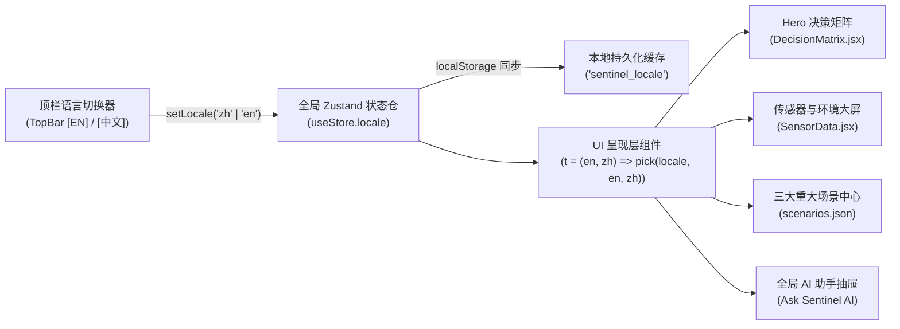

# Sentinel 7.0 双语国际化架构与专业术语词典规范
# (Bilingual Architecture & Agribusiness Localization Spec)

> **版本：** Sentinel 7.0.0  
> **核心原则：** 遵循现有系统的 `locale` 切换架构（顶栏一键切换 `EN` / `中文`，全局状态同步，组件层通过 `pick(locale, en, zh)` 消费）；**中文版严格符合中国高科技农业工厂与企业高管的语言习惯与专业口吻，坚决杜绝生硬机翻；同时自然保留行业公认的通用英文缩写（如 PHI, Grade A, D+3, SLA, KA, KPI, AI, IoT, EC/pH 等）**。

---

## 一、 双语无缝切换架构设计 (Architecture & State Flow)

系统完全沿用并深化工程已有的国际化机制（`src/i18n/locale.js` 与 `src/engine/store.js`）：



### 1.1 关键交互准则
1. **零刷新瞬时切换：** 切换语言时，当前页面无刷新更新所有文字、数值后缀、状态徽章与图表图例，当前选择的方案（如已选方案 B）、边界仿真推演滑块状态、密码学存证编号完整保持不变。
2. **场景数据双语同源：** `docs/v7.0/scenarios.json` 内每一个重大场景与每一种方案均配有原生的 `name` / `name_en`，`action` / `action_en`，`wins_when` / `wins_when_en`，由组件直接根据当前 `locale` 动态提取，不依赖临时机器翻译。
3. **全局 AI 智能感知语种：** 当用户在全局 AI 抽屉中提问时，AI 提示词注入当前 `locale`，英文模式下回复地道英文，中文模式下回复专业、符合中国农业经营习惯的中文。

---

## 二、 中文语言习惯与保留英文准则 (Localization Principles)

### 2.1 拒绝生硬机翻，遵循中国农业工厂真实语境
*   **不翻译成生僻或直译怪词：**
    *   ❌ 直译：“处方卡片 (Prescription Card)” ➔ ✔ 贴切翻译：“**经营决策方案**” 或 “**专家共识处方**”
    *   ❌ 直译：“采收前遏制 (Harvest-First Containment)” ➔ ✔ 贴切翻译：“**抢收优先 + 零喷洒**”
    *   ❌ 直译：“选择性释放 (Selective Release)” ➔ ✔ 贴切翻译：“**针对性隔离放行**”
    *   ❌ 直译：“全部作物保护 (Full Crop Protection)” ➔ ✔ 贴切翻译：“**全区化学植保 (长效资产保全)**”
    *   ❌ 直译：“执行被锁住 (Execution Locked)” ➔ ✔ 贴切翻译：“**执行闭锁 (门禁拦截)**”
    *   ❌ 直译：“决策准备好了 (Decision Ready)” ➔ ✔ 贴切翻译：“**决策就绪 (联锁待发)**”
    *   ❌ 直译：“强力跑者向上 (Strong Runner-up)” ➔ ✔ 贴切翻译：“**强力第二优选**”

### 2.2 规范保留的国际与行业通用英文缩写
中国现代设施农业、生鲜供应链及企业管理中已普遍将以下名词作为标准口语或书面术语使用，中文版保持原样呈现，更具工业专业质感：
*   **PHI** (Pre-Harvest Interval)：农药采前安全间隔期。国内绿色果品出口及高端商超统一简写为 PHI。
*   **Grade A / Grade B**：果品等级标准（特级精品果 / A级果 / B级果）。
*   **D+3 / D+1**：交货倒计时（D 为发车基准日，D+3 表示3天后交付，国内生鲜供应链标准缩写）。
*   **SLA** (Service Level Agreement)：服务履约条款或合同品质交付协议。
*   **KA** (Key Account)：重点直供渠道大客户（盒马鲜生、山姆会员店、华润 Ole' 等）。
*   **KPI** (Key Performance Indicator)：关键运营与经营绩效指标。
*   **FTE** (Full-Time Equivalent)：全职工时当量（用于采摘、分拣工人排班测算）。
*   **EC / pH**：基质滴灌电导率与酸碱度。
*   **UV**：紫外线指数。
*   **JSON-LD / SHA-256**：不可篡改存证与审计数据标准。
*   **Ontology**：运行本体模型。
*   **Agent**：智能体（专家模型）。

---

## 三、 决策中心 (`DecisionMatrix.jsx`) 核心双语术语对照表

### 3.1 顶部 5 大黄金运营 KPI (Top 5 Operational KPIs)
| 英文展示 (EN) | 英文副标 (EN Subtext) | 中文规范呈现 (ZH) | 中文说明 (ZH Subtext) |
|---|---|---|---|
| **PEST RISK 68/100\*** | Threshold breached >60 | **虫害风险 68/100\*** | 突破预警阈值 (>60) |
| **GRADE A RELEASE 700-850 kg\*** | Estimated packout volume | **特级鲜果放行 700-850 kg\*** | 预估可包装出库量 |
| **CUSTOMER ORDER 750 kg / D+3** | Contract SLA: Premium Retail | **商超订单 750 kg / D+3** | 盒马精品直供 SLA |
| **LABOR 25 today / 12 tomorrow\*** | Crew shift allotment (FTE) | **用工人手 25人今日 / 12人明日\*** | 采摘工班排班 (FTE) |
| **TREATMENT route pending** | Awaiting compliance validation | **处置路线 待核准** | 等待合规与 PHI 验证 |

---

### 3.2 六大专家共识矩阵徽章 (Specialist Consensus Matrix)
| 专家标识 | 状态徽章 (EN) | 状态徽章 (ZH) | 核心研判考量 (EN) | 核心研判考量 (ZH) |
|---|---|---|---|---|
| **SENSOR / DATA** | `0.99 CONF` | `置信度 0.99` | Signal credible? | 传感信号真实可信？ |
| **AGRONOMIST** | `ACTIVE` | `研判中` | Protect crop value? | 如何保全树体资产？ |
| **COMPLIANCE** | `CHECK PHI` | `核查 PHI` | Permitted route? | 用药是否触碰红线？ |
| **OPERATIONS** | `CREW OK` | `人手就绪` | Executable today? | 今日人手冷库能否承接？ |
| **SALES / QUALITY** | `HIGH PRIO` | `高优先级` | Fulfil the order? | 能否保住商超履约信誉？ |
| **FINANCE** | `NET MARGIN` | `净利核算` | Protect contribution? | 方案落袋多少真金白银？ |

---

### 3.3 策略对比三列矩阵 (Strategy Columns: A, B, C)

| 行名 (Row) | 方案 A (Plan A) | 方案 B (Plan B · 首选) | 方案 C (Plan C · 强力次选) |
|---|---|---|---|
| **ACCOUNT (方案方案名)** | **EN:** A FULL CROP PROTECTION<br>**ZH:** 方案 A：全区化学植保 (长效资产保全) | **EN:** B SELECTIVE RELEASE + CONTAINMENT<br>**ZH:** 方案 B：针对性隔离放行 + 生物控害 | **EN:** C HARVEST-FIRST & ZERO-SPRAY<br>**ZH:** 方案 C：抢收优先 + 零喷洒 |
| **ACTION (行动安排)** | **EN:** Treat block / Delay or cover order<br>**ZH:** 全棚化学喷药杀菌，保全树体花芽，协调商超延期交货或备选批次调拨 | **EN:** Test lots and release cleared fruit / Sanitize and protect remaining crop<br>**ZH:** 质检放行 LOT-01/02 (780kg)；隔离 LOT-03 (120kg) 并微喷哈茨木霉菌剂 | **EN:** No spray yet / Immediate harvest and optical color sorting<br>**ZH:** 完全不喷任何药剂，25人立即进棚抢收，采后严格光电色选分拣，24h动态复测 |
| **ECONOMICS (经济账)** | **EN:** Sales: 41-46k \| Cost: 13-18k \| NET: 23-33k<br>**ZH:** 销售额: 4.1-4.6万 \| 成本: 1.3-1.8万 \| **净利润: 2.3-3.3万元** | **EN:** Sales: 42-48.75k \| Cost: 6.7-11.8k \| **NET HIGHEST: 30-35k**<br>**ZH:** 销售额: 4.2-4.88万 \| 成本: 0.67-1.18万 \| **综合净利最高: 3.0-3.5万元** | **EN:** Sales: 38-42k \| Cost: 8-11k \| **NET: 25-28k**<br>**ZH:** 销售额: 3.8-4.2万 \| 成本: 0.8-1.1万 \| **次优净利: 2.5-2.8万元** |
| **RISK & OBLIGATION (多维评级)** | **EN:** Crop 5/5 \| Compliance 3/5 \| Customer 2/5<br>**ZH:** 作物安全 5/5 \| 合规评级 3/5 \| 客户履约 2/5 | **EN:** Crop 4/5 \| Compliance 5/5 \| Customer 5/5<br>**ZH:** 作物安全 4/5 \| 合规评级 5/5 \| 客户履约 5/5 | **EN:** Crop 3/5 \| Compliance 5/5 \| Customer 4/5<br>**ZH:** 作物安全 3/5 \| **合规评级 5/5 (零农残)** \| 客户履约 4/5 |
| **EXECUTION (执行复杂度)** | **EN:** Ease 4/5 · Conventional spraying<br>**ZH:** 执行难度 4/5 · 常规整棚喷药简单易行 | **EN:** Ease 2/5 · Released lots + crew + cold room allocation<br>**ZH:** **执行难度 2/5 · 最繁琐 (需拉隔离带/无人机飞防/分仓)** | **EN:** Ease 5/5 · Immediate picking without machines<br>**ZH:** **执行难度 5/5 · 最简便纯粹 (工人直接采摘，无需农机)** |
| **WINS WHEN (胜出翻转条件)** | **EN:** Risk is widespread and replacement fruit is secured<br>**ZH:** 病害大面积失控且商超书面同意延期 10 天交货时翻转为首选 | **EN:** ≥750 kg clears quality and PHI route. Capacity is confirmed.<br>**ZH:** 现场具备精细化批次隔离、无人机微量对靶喷施与冷库分仓能力时综合最优 (当前基准推荐) | **EN:** Drone is down, or customer strictly requires 100% zero-spray organic protocol.<br>**ZH:** **当无人机突发故障、大风无法起飞，或客户要求“100% 纯天然零制剂纯绿色认证”时瞬间翻转为第一优选！** |
| **STATUS (状态标签)** | `[• CONDITIONAL / BLOCKED]`<br>`[• 条件受阻]` | `[✔ CURRENT LEAD / OPTIMAL]`<br>`[✔ 当前综合首选]` (绿标高亮) | `[• STRONG RUNNER-UP]`<br>`[• 强力第二优选]` (琥珀金标) |

---

### 3.4 三道联锁硬门禁卡片 (3 Interlocked Decision Gates)

```
┌────────────────────────────────────────────────────────────────────────────────────────┐
│ 英文版 (EN):                                                                           │
│  [QUALITY: ≥750 kg VERIFIED]   [COMPLIANCE: Label+PHI valid CLEARED]  [CAPACITY: RESERVED] │
│                                                                                        │
│ 中文版 (ZH):                                                                           │
│  [品质门禁: ≥750 kg 质检通过]  [合规门禁: 农药标号与 PHI 检验放行]   [产能门禁: 工班与冷库锁定]│
│  • 780kg 特级鲜果已达标入库     • 哈茨木霉菌 0天 PHI 100% 合规        • 25人采摘队+1号冷库已锁定│
└────────────────────────────────────────────────────────────────────────────────────────┘
```

---

### 3.5 决策准备与主控操作栏 (Control Bar)

| 功能元素 | 英文 (EN) | 中文规范呈现 (ZH) | 说明与行为 |
|---|---|---|---|
| **闭锁状态** | `🔒 EXECUTION LOCKED` | `🔒 执行闭锁 (门禁拦截)` | 当门禁未通过或选择违规方案 A 时展示 |
| **就绪状态** | `🔓 DECISION READY` | `🔓 决策就绪 (联锁待发)` | 方案满足全部 3 道门禁时展示 |
| **状态说明条** | `B leads now: strongest modeled contribution while protecting the D+3 order.` | `当前方案 B 综合领跑：在全力保住 D+3 订单履约的前提下实现最大化净收益。` | 顶部动态研判总评 |
| **主操作按钮** | `⚡ AUTHORIZE DISPATCH (INTERLOCKED)` | `⚡ 确认联锁派单 (加密存证)` | 核心行动按钮，触发数字签名与工单派发 |
| **仿真推演按钮** | `📊 Simulate Boundary Conditions` | `📊 模拟极端工况 / 边界推演` | 弹出条件推演滑块与故障模拟 |
| **存证导出按钮** | `⬇ Export Immutable Audit Packet (.JSON-LD)` | `⬇ 导出不可篡改审计数据包 (.JSON-LD)` | 供绿色认证机构或商超质检溯源 |

---

## 四、 三大重大场景的完整双语数据结构设计 (`scenarios.json`)

系统三大重大场景已升级为双语全覆盖，核心结构如下：

```json
{
  "id": "SCENARIO-01-PEST-PHI",
  "name": "智能诱捕器发出虫害预警与 750kg 订单履约 PHI 冲突",
  "name_en": "Connected Trap Pest Warning vs D+3 750kg Order & PHI Conflict",
  "badge": "CRITICAL · PEST & PHI",
  "badge_zh": "重大险情 · 虫害与 PHI 冲突",
  "key_kpis": {
    "days_to_delivery": "3 DAYS",
    "days_to_delivery_zh": "3 天后交付 (D+3)",
    "order_volume": "750 kg GRADE A BLUEBERRIES",
    "order_volume_zh": "750 公斤 特级精品蓝莓",
    "farm_scale": "900 mu Mega-Facility · South-B3 Block (20 mu, 3,200 plants)",
    "farm_scale_zh": "900 亩现代化超级工厂 · 南区 B3 连栋棚 (20 亩，3,200 株优瑞卡)",
    "labor_today": "25 pickers today (Crew-25 on duty)",
    "labor_today_zh": "25 名在岗采工 (CREW-25 专属采收班组)"
  }
}
```

---

## 五、 日常 24/7 自主运营微场景双语对照 (Track 1)

日常无需人工介入、AI 自行闭环的小场景，在左/右侧动态流水（Activity Rail）中支持双语无缝切换：

1. **午后微湿对流通风：**
   *   **EN:** `[AUTO-EXEC] Heat & Humidity Spike (82.5%): Axial fans #3 & #4 activated at 60% power. Relieved to 71.0% in 15 mins.`
   *   **ZH:** `[自主闭环] 午后湿热积聚预警 (湿度 82.5%)：3/4 号轴流风机自适应启动排风 20 分钟，湿度平稳回落至 71.0%。`
2. **基质水分脉冲微灌：**
   *   **EN:** `[AUTO-EXEC] Substrate Moisture Deficit (27.2%): Pulse fertigation line #2 active for 12 mins. Restored to 33.2%.`
   *   **ZH:** `[自主闭环] 基质微亏水预警 (含水率 27.2%)：2号压力补偿滴灌电磁阀补水 12 分钟，基质含水率恢复至 33.2%。`
3. **短时阵风规避顺延：**
   *   **EN:** `[AUTO-EXEC] Wind Gust Warning (4.6 m/s): Multispectral drone inspection flight deferred by 30 mins.`
   *   **ZH:** `[自主闭环] 澄江局部短时阵风规避 (4.6 m/s)：多光谱无人机巡检任务自动顺延 30 分钟，风速平稳后自动起飞。`
4. **诱虫板萌芽期低密度巡查：**
   *   **EN:** `[AUTO-EXEC] Low Thrip Count (3 thrips): Marked for tomorrow's ground scouting. Chemical treatment prohibited.`
   *   **ZH:** `[自主闭环] 智能诱虫板低密度预警 (捕获3只蓟马)：自动派发明日人工巡检标记，维持零用药绿色标准。`

---

## 六、 落实到组件层的实现方式 (Developer Guidelines)

在后续编码实现（如编写 `DecisionMatrix.jsx`）时，遵循极简、标准的代码规范：

```jsx
import { pick } from '../i18n/locale.js';
import useStore from '../engine/store.js';

export default function DecisionMatrix() {
  const { locale } = useStore();
  const t = (en, zh) => pick(locale, en, zh);

  return (
    <div className="decision-matrix-card">
      <div className="kpi-header">
        <span className="label">{t('PEST RISK', '虫害风险指数')}</span>
        <span className="sub">{t('Threshold breached >60', '突破预警阈值 (>60)')}</span>
      </div>
      
      {/* 方案 C 强力次选标签 */}
      <span className="badge-runner-up">
        {t('• STRONG RUNNER-UP', '• 强力第二优选')}
      </span>
      
      {/* 门禁卡片 */}
      <div className="gate-chip">
        {t('QUALITY: ≥750 kg VERIFIED', '品质门禁: ≥750 kg 质检通过')}
      </div>
    </div>
  );
}
```

这样既确保了**极高质量的专业中文体验**，又完全兼容国际化展示，且代码简洁优雅，没有任何重型三方国际化库的依赖负担。