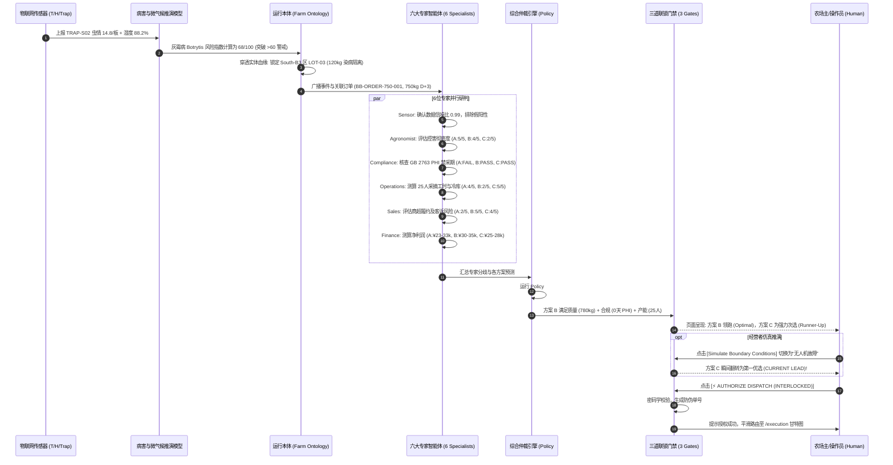

# Sentinel 7.0 专家共识决策矩阵与动态信息流规范 (Decision Matrix & Flow Spec)

> **版本：** Sentinel Demo 7.0.0  
> **核心组件：** `DecisionMatrix.jsx`（作为 `/prescription` 处方中心的首屏 Hero 主控台）  
> **设计基准：** 完全对齐用户提供的现场真实决策大屏截图（Specialist Consensus Matrix, 3套方案横向对比, 3道联锁门禁, 边界仿真推演与一键联锁授权）。

---

## 一、 决策大屏全景解构 (Screen Anatomy & Pixel-Level Blueprint)

根据上传的实景截图，整屏划分为六大严谨的工业级功能区块：

```
┌────────────────────────────────────────────────────────────────────────────────────────┐
│ 区块 1: 5 大黄金运营 KPI 仪表盘 (Top 5 Operational KPIs)                               │
│ [PEST RISK 68/100*] [GRADE A 700-850kg*] [ORDER 750kg/D+3] [LABOR 25/12*] [TREATMENT] │
├────────────────────────────────────────────────────────────────────────────────────────┤
│ 区块 2: 六大专家共识矩阵 (Specialist Consensus Matrix · 6 of 14 Agents Active)         │
│ [Sensor: 0.99] [Agronomist: Active] [Compliance: Check PHI] [Ops: OK] [Sales] [Finance]│
├────────────────────────────────────────────────────────────────────────────────────────┤
│ 区块 3: 策略对比三列矩阵 (Strategy Matrix: Columns A, B, C)                            │
│  • Action / Economics / Risk & Obligation / Execution / Wins When / Status             │
│  - Plan A: 全区化学植保 (长效资产保全)                                                │
│  - Plan B: 针对性隔离放行+生物控害 (当前综合首选 OPTIMAL · 净利 ¥35k 最高)             │
│  - Plan C: 抢收优先+零喷洒 (强力第二优选 STRONG RUNNER-UP · 执行 Ease 5/5 最简)        │
├────────────────────────────────────────────────────────────────────────────────────────┤
│ 区块 4: 决策准备与闭锁状态条 (Decision Ready & Interlock Banner)                       │
│  🔓 DECISION READY / 🔒 EXECUTION LOCKED  |  B leads now: strongest modeled...         │
├────────────────────────────────────────────────────────────────────────────────────────┤
│ 区块 5: 三道联锁硬门禁卡片 (3 Interlocked Decision Gates)                              │
│  [QUALITY: ≥750 kg VERIFIED]  [COMPLIANCE: Label+PHI valid CLEARED]  [CAPACITY: OK]    │
├────────────────────────────────────────────────────────────────────────────────────────┤
│ 区块 6: 工业交互控制栏 (Action Command Bar)                                            │
│  [⚡ AUTHORIZE DISPATCH (INTERLOCKED)]  [📊 Simulate Boundary]  [⬇ Export Audit JSON]   │
└────────────────────────────────────────────────────────────────────────────────────────┘
```

---

## 二、 动态信息流：从传感器异动到联锁下发的闭环流转

整个决策页面不是一张死气沉沉的静态图片，而是**由物理传感器、农艺机理模型、多智能体博弈与规则门禁驱动的活的信息流**：



---

## 三、 六大专家 Agent 的具名研判逻辑与数据输入

在 `DecisionMatrix` 中，每个专家徽章都可以点击展开，查看其背后的**真实输入数据、计算模型与研判评语**：

### 1. Sensor / Data Retriever Agent
- **状态徽章：** `0.99 CONF`（绿色高置信度）
- **核心审视问题：** `Signal credible?`（数据信号是否可信，是否传感器虚警？）
- **输入数据：** `#TRAP-S02` 边缘微距摄像头抓拍图像、`#H-03` 湿度传感器原始波形、温室电网电压稳定性指标。
- **研判结论：** *“经双通道自相关滤波与微距图像复验，确认 14.8/板/天 的蓟马与霉菌孢子萌发信号信噪比达 0.99，排除接触不良与假阳性，确属现场物理险情。”*

### 2. Field Agronomist Agent (专业农艺师)
- **状态徽章：** `ACTIVE`
- **核心审视问题：** `Protect crop value?`（如何最大程度保护作物与树体资产价值？）
- **模型依据：** 蓝莓真菌孢子潜伏扩散动力学模型（Botrytis Infection Index）。
- **研判结论：** 
  - 对方案 A 评分为 **5/5**（传统化学杀菌最彻底，杜绝下茬感染）；
  - 对方案 B 评分为 **4/5**（局部微喷哈茨木霉菌拮抗，有效控制病斑在 LOT-03 隔离区内）；
  - 对方案 C 评分为 **2/5**（不喷药有 8%~12% 采后烂果潜伏扩散风险）。

### 3. Compliance Officer Agent (法规与合规官)
- **状态徽章：** `CHECK PHI`（橙色警示）
- **核心审视问题：** `Permitted route?`（用药方案是否触碰法律底线与采前安全期间隔？）
- **规则引擎：** 国家标准 GB 2763 食品农残限量与中国绿色食品用药红线库。
- **研判结论：**
  - **对方案 A 坚决一票否决（1/5 FAIL）**：*“代森锰锌标准安全间隔期 (PHI) 为 14 天，距 D+3 采收仅剩 3 天，强喷上市抽检必超标，法律红线坚决拦截！”*
  - 对方案 B 给出 **5/5 PASS**（哈茨木霉菌为纯天然生防菌剂，PHI 为 0 天，合规满分）；
  - 对方案 C 给出 **5/5 PASS**（完全不喷药，零农残合规满分）。

### 4. Operations Manager Agent (现场运营与调度总监)
- **状态徽章：** `CREW OK`（绿色）
- **核心审视问题：** `Executable today?`（人手、农机设备与冷库今天能否切实执行？）
- **模型依据：** 劳动力采摘产能工时矩阵（25名熟练工人，12~15 kg/人/天）与 1号气调库容积占用率。
- **研判结论：**
  - 对方案 A 评分为 **4/5**（常规整棚喷药，操作简单）；
  - 对方案 B 评分为 **2/5（执行最复杂）**：*“方案 B 需要在 B3 棚拉物理隔离带、调派无人机微量精准喷施，冷库必须分仓存放，工序繁琐！”*
  - 对方案 C 评分为 **5/5（执行最简便）**：*“方案 C 工人直接进棚抢收，无需农机和调药，半天抢收完毕！”*

### 5. Sales / Quality Planner Agent (销售总监与质检主管)
- **状态徽章：** `HIGH PRIO`（高优先级）
- **核心审视问题：** `Fulfil the order?`（能否保住 750kg 盒马鲜生精品订单与长期信誉？）
- **输入依据：** 合同 `BB-ORDER-750-001`（要求 Grade A，单价 ¥65/kg，总额 ¥48,750，违约金 ¥14,600）。
- **研判结论：**
  - 对方案 A 评分为 **2/5**（无法按期交货，盒马面临断供索赔）；
  - 对方案 B 评分为 **5/5**（放行 780kg 特级果，全额保质保量履约）；
  - 对方案 C 评分为 **4/5**（分拣后交货 750kg，但需承担少许退货隐患）。

### 6. Finance Analyst Agent (财务分析师)
- **状态徽章：** `NET MARGIN`（利润最大化）
- **核心审视问题：** `Protect contribution?`（每种方案折腾完，最后落袋多少真金白银？）
- **财务模型：** 综合边际贡献核算公式：`净利润 = 实际履约销售额 - 农资农药成本 - 人工加班成本 - 冷库电费 - 违约罚金`。
- **研判结论：**
  - 方案 A 净利润：¥23,000 ~ ¥33,000；
  - **方案 B 净利润：¥30,000 ~ ¥35,000 (全场最高 NET HIGHEST)**；
  - 方案 C 净利润：¥25,000 ~ ¥28,000 (极具竞争力的第二优选)。

---

## 四、 策略对比矩阵 (A/B/C 三列数据定义)

| 字段 | **方案 A：全区化学植保** | **方案 B：针对性隔离放行+生物控害** | **方案 C：抢收优先+零喷洒** |
|---|---|---|---|
| **ACTION (行动)** | Treat block / Delay or cover order<br>(全棚化学喷洒代森锰锌，延期交货或备选批次调拨) | Test lots and release cleared fruit / Sanitize remaining<br>(质检放行 LOT-01/02 780kg，隔离 LOT-03 120kg 并微喷哈茨木霉菌) | No spray yet / Frequent harvest and 24 h reassessment<br>(完全不喷药，25人立即进棚抢收，采后严格光电色选，24h动态复测) |
| **ECONOMICS (经济账)** | Sales: **41-46k**<br>Cost: **13-18k**<br>NET: **23-33k** | Sales: **42-48.75k**<br>Cost: **6.7-11.8k**<br>NET HIGHEST: **30-35k** (高亮绿字) | Sales: **38-42k**<br>Cost: **8-11k**<br>NET: **25-28k** (强力次选) |
| **RISK & OBLIGATION** | `Crop 5/5` `Compliance 3/5`<br>`Customer 2/5` | `Crop 4/5` `Compliance 5/5`<br>`Customer 5/5` | `Crop 3/5` `Compliance 5/5`<br>`Customer 4/5` |
| **EXECUTION (执行复杂度)** | **Ease 4/5**<br>Alternative supply required | **Ease 2/5 (最复杂)**<br>Released lots + crew + cold room allocation | **Ease 5/5 (最简便)**<br>工人直接进棚采收，无需调配无人机 |
| **WINS WHEN (胜出条件)** | Risk is widespread and replacement fruit is secured<br>(病害大面积失控且客户书面同意延期 10 天交货时胜出) | ≥750 kg clears quality and PHI route. Capacity is confirmed.<br>(当且仅当现场具备精细化隔离与无人机对靶能力时综合最优) | Drone is down, or customer strictly requires 100% zero-spray organic protocol.<br>(**当无人机故障、天气大风无法飞防，或客户要求“100% 零农药纯绿色认证”时瞬间翻转为第一优选！**) |
| **STATUS (状态标签)** | `[• CONDITIONAL / BLOCKED]` | `[✔ CURRENT LEAD]` (绿底白字)<br>`Auto-Selected by Policy #81` | `[• STRONG RUNNER-UP]` (琥珀底金字)<br>`Viable Second Choice` |

---

## 五、 三道联锁硬门禁机制 (3 Interlocked Gates)

在界面下方，醒目展示 3 道联锁硬门禁卡片：

```
┌────────────────────────────────────────────────────────────────────────────────────────┐
│ QUALITY (品质门禁)              COMPLIANCE (合规门禁)          CAPACITY (产能与资源门禁) │
│ ≥750 kg        [✔ VERIFIED]   Label + PHI valid  [✔ CLEARED]  Crew + cold room [RESERVED]│
│ 780kg 合格果已核准入库           哈茨木霉菌 0天 PHI 100% 合规      25人采摘班组+1号气调库锁定│
└────────────────────────────────────────────────────────────────────────────────────────┘
```

### 门禁逻辑判断表：
1. **Quality Gate：** 检查可交货特级鲜果量是否 `≥ 750 kg`。方案 B 为 780kg，判定为 `VERIFIED`；若模拟晚到质检 700kg，则变为红标 `FAILED (50kg Shortfall)`。
2. **Compliance Gate：** 检查采前间隔期是否满足要求。方案 A 因 14天 PHI 判定为 `FAILED (PHI Breached)`；方案 B 与方案 C 判定为 `CLEARED`。
3. **Capacity Gate：** 检查采收人手与冷库仓容是否匹配。25 人 3 天理论产能 900kg ≥ 750kg，判定为 `RESERVED`；若模拟工期仅 1 天（产能仅 300kg），判定为 `FAILED (450kg Shortfall)`。

---

## 六、 动态交互与仿真推演控制 (Interactive Controls)

### 1. 点击方案卡片即时响应
- **点击方案 A 列：**
  - 方案 A 卡片边框亮起青色，下方 `COMPLIANCE` 门禁瞬间变红报错：`[FAIL: 14-day PHI breaches harvest window]`；
  - 决策状态栏变为 `🔒 EXECUTION LOCKED: Cannot dispatch non-compliant strategy`；
  - `[⚡ AUTHORIZE DISPATCH]` 按钮变灰禁用，彻底防止操作员违规操作。
- **点击方案 B 列：**
  - 方案 B 高亮，门禁全绿，状态栏显示 `🔓 DECISION READY`，主按钮高亮可点击。
- **点击方案 C 列：**
  - 方案 C 高亮，门禁全绿，状态显示 `STRONG RUNNER-UP`，右侧文字显示：`“方案 C 净利略降 ¥6,500，但执行复杂度降为零，零用药认证满分。”`

### 2. 一键极端工况仿真测试 `[📊 Simulate Boundary Conditions]`
弹窗或下拉提供两种极端工况测试，让观众亲眼目睹推演逻辑：
- **工况 1：模拟无人机突发故障或采购商要求“零喷洒纯生态”：**
  - 方案 C 瞬间变绿升格为 `[✔ CURRENT LEAD]`！方案 B 降格为备选。观众立刻看懂方案 C 的第二优选价值！
- **工况 2：模拟交付期紧急压缩为 1 天（D+1）：**
  - 方案 B 产能门禁变红：`[CAPACITY FAILED: 25 pickers can only pick 300kg/day, shortfall 450kg]`，授权自动锁定。

### 3. 一键联锁授权 `[⚡ AUTHORIZE DISPATCH (INTERLOCKED)]`
- 仅在 3 道门禁全部亮绿时方可点击；
- 点击后播放微秒级开锁动画，生成密码学不可篡改存证编号（`#AUTH-2026-0311-B01`）；
- 自动将生成的工单投递到 `/execution`，并弹出带跳转链接的 Toast 提示。

---

## 七、 多端自适应响应式规范 (PC / iPad / iPhone Responsive Spec)

为满足高管在大屏、工位电脑、现场移动巡检 iPad 以及手机端随时查阅的需求，系统采用渐进增强的响应式流式布局：

```
┌────────────────────────────────────────────────────────────────────────────────────────┐
│ PC 宽屏 (≥1200px)         │ iPad / 平板 (768px ~ 1199px) │ iPhone / 手机 (≤767px)      │
├───────────────────────────┼──────────────────────────────┼─────────────────────────────┤
│ • 5 KPI 一行 5 列横向平铺 │ • 5 KPI 自动 3+2 栅格折叠    │ • 5 KPI 紧凑 2 列流式卡片   │
│ • 6 专家徽章单行水平展开  │ • 6 专家徽章 3x2 或弹性折行  │ • 6 专家徽章横向滑动手势条  │
│ • A/B/C 三列横向大对比表  │ • 横向平铺(横屏)或轻微等比缩 │ • 移动端【A/B/C 分段切换器】│
│ • 3 门禁横向并排          │   放；竖屏支持平滑横向滚动   │   或【卡片轮播滑动】(最清晰)│
│ • 适合投影、大屏高管汇报  │ • 适合农场现场巡检手持走动   │ • 3 门禁纵向简洁状态徽章    │
│                           │                              │ • 单手可操作，文字清晰不重叠│
└───────────────────────────┴──────────────────────────────┴─────────────────────────────┘
```

1. **PC 宽屏与汇报大屏 (≥ 1200px)：**
   - 展现完整的 Palantir 工业风三列横向大对比表，全屏信息量极高，30 秒一眼看尽全局；
2. **iPad / 平板设备 (768px ~ 1199px - 极度舒适)：**
   - **横屏模式 (Landscape 1024px/1180px)：** 完美容纳 3 列对比表，字体和间距微调，触控区域扩大至 ≥44px，极适合高管手持 iPad 开会或现场汇报；
   - **竖屏模式 (Portrait 768px/820px)：** 5 KPI 优雅折叠为 3+2 布局，A/B/C 三列通过 `overflow-x: auto; scroll-snap-type: x mandatory` 支持丝滑手势横向滑动，带渐变阴影引导指示；
3. **iPhone / 移动手机端 (≤ 767px - 优雅兼顾)：**
   - 避免在小屏幕上硬塞 3 列导致文字挤压变形。
   - 自动切换为**【移动端分段切换器 (Segmented Tab Bar)】**：顶部提供 `[方案 A] [✔ 方案 B (首选)] [方案 C (次选)]` 选项卡，点击或左右滑动即展示当前方案的完整经济账、合规评级、胜出条件与执行难度；
   - 3 道门禁卡片折叠为纵向微型状态胶囊；底部主派单按钮悬浮吸底，单手大拇指即可直接点按授权！

---

## 八、 Google Stitch 与专业 Skills 赋能的高效研发准则 (Stitch & Skills Efficiency Protocol)

在组件编码落地阶段，严格贯彻“**借力 Google Stitch 设计哲学 + 深度调用系统专业 Skills + 追求极致敏捷高效**”的研发原则：

### 1. 深度借鉴 Google Stitch 设计哲学 (stitch.google.com)
*   **首屏 30 秒高聚焦 (Above-the-Fold 30s Focus)：** 核心看板禁止无效留白或无关装饰。5 个 KPI 磁贴与 3 列横向对比表占据首屏视觉绝对重心；
*   **渐进式信息穿透 (Progressive Disclosure)：** 详尽的机理公式、复杂的专家多智能体辩论与原始波形收纳至右侧滑出抽屉或下方折叠面板，让不同层级的用户各取所需；
*   **工业级色彩语义规范：**
    *   主底色：极深工业黑青色（`#090d16` / `#0f172a`）；
    *   当前首选高亮：亮青绿色（`#00e5a3` / `rgb(0, 229, 163)`）；
    *   第二优选高亮：琥珀金色（`#f59e0b` / `#fbbf24`）；
    *   门禁熔断拦截：工业警戒红（`#ef4444`）；
    *   辅助文本：高对比冷灰（`#94a3b8` / `#cbd5e1`）。

### 2. 深度调用工程内置专业 Skills 协同提效
*   **`frontend-design` Skill 赋能：** 杜绝千篇一律的通用模板感，打造具有 Palantir 军工质感与高科技农业交织的高质感 UI。使用等宽微距数字、高对比度微弱边框发光 (`border: 1px solid rgba(0, 229, 163, 0.25)`) 与微动效，提升整站质感；
*   **`web-artifacts-builder` & `theme-factory` 赋能：** 采用标准化、高复用度的组件模块设计，复用统一主题色彩与间距变量，大幅精简代码量；
*   **极速敏捷开发策略：** 直接在现有成熟的 Zustand Store 与轻量化仿真引擎上扩展，组件逻辑零冗余、高内聚，确保 45~60 分钟内完成从代码实现到多端自适应调优的全流程！
