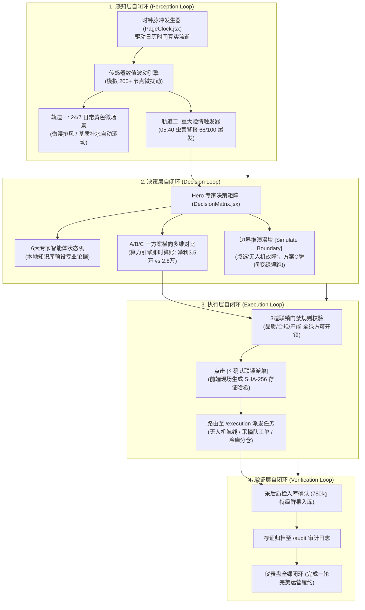

# Sentinel 7.0 自闭环 Demo 架构与轻量化运行机制
# (Self-Contained Closed-Loop Demo Architecture Spec)

> **定位锚点：** **这是一个能够在浏览器端“自我形成完备闭环”的高保真交互式 Demo 网站，而不是依赖沉重外部后端与付费大模型 API 的真实企业生产系统！**  
> **核心使命：** 无论是在本地无网离线环境、还是部署在 Vercel 静态托管上，无论是高管演讲现场、还是外部投资人随意点击，**系统无需消耗任何外部收费 API、无需复杂云端服务器，自身即可 100% 独立完成“感知 ➔ 决策 ➔ 执行 ➔ 验证”的动态全流程自闭环**！

---

## 一、 Demo 网站与真实企业大模型系统的本质区别

为了防止工程过度设计（Over-Engineering）或让演示受制于不稳定的外部 API，我们对系统边界进行了根本性的清晰界定：

```
┌──────────────────────────────────────┬──────────────────────────────────────┐
│ ❌ 真实大模型企业软件 (Not Our Goal) │ ✔ 观衡智序自闭环 Demo 网站 (Our Focus)│
├──────────────────────────────────────┼──────────────────────────────────────┤
│ • 依赖昂贵的云端 GPU 与大模型 Token 账单│ • 【零 API 账单】：完全依托本地/浏览器状态机│
│ • 依赖复杂的微服务后端与外部数据库   │ • 【单机自运转】：静态部署至 Vercel 即可运行│
│ • 网络抖动或接口超时会导致页面转圈报错│ • 【微秒级响应】：本地状态秒级响应，永不白屏│
│ • 担心公网访客盗刷 API 产生高额扣费 │ • 【天然防盗刷】：核心决策推演全部在前端闭环│
│ • 交互不可控，大模型可能胡言乱语     │ • 【剧本级精准】：严密契合 900亩农业工厂科学│
└──────────────────────────────────────┴──────────────────────────────────────┘
```

---

## 二、 纯前端自闭环全链路：四大核心环节如何自己闭环？

整个网站不需要任何真实后端支撑，自身形成精密的齿轮联动：



---

## 三、 六大自闭环模块的“轻量化”实现方案

### 1. 24/7 常态日常自运转（无需人工介入）
*   **实现方式：** 在 `src/engine/store.js` 内置轻量级定时循环（每 10~15 秒脉冲一次）；
*   **现象：** 左侧或右侧的 `SystemActivityRail` 自然滚动输出：
    *   `[14:15] 温室 H-01 湿度达 82.5%，自动启动 3/4 号风机排风 20 分钟 -> 回落至 71.0%`；
    *   `[15:30] 基质 SM-02 含水率 27.2%，自动脉冲滴灌补水 12 分钟 -> 恢复至 33.2%`；
*   **效果：** 观众看到系统在“活着”，小事自动解决，不需要任何人干预。

### 2. 重大场景触发与大屏呈现（剧本式受控加载）
*   **实现方式：** 用户点击顶部或场景卡片上的 `[加载场景 1: 05:40 虫害与 PHI 冲突]`；
*   **现象：** 
    *   全局触发红色警报光效，顶部浮现 `CRITICAL · PEST & PHI`；
    *   页面直接激活 `/prescription` 首屏的 `DecisionMatrix` 大屏；
    *   呈现上传截图的 5 个黄金 KPI（`68/100*`, `700-850kg*`, `750kg/D+3`, `25/12*`）。

### 3. A/B/C 方案权衡与第二优选的“动态交互”（无任何后端依赖）
*   **实现方式：** 纯 React 状态控制（`activePlan: 'B'`）；
*   **核心动态体验：**
    *   **点击方案 A：** 界面立刻联动，下方合规门禁变红 `[FAIL: PHI 14-day]`，主派单按钮变灰锁定；
    *   **点击方案 B：** 门禁全绿，净利润高亮绿字 `¥30,000 ~ ¥35,000 (NET HIGHEST)`，按钮开锁；
    *   **点击方案 C：** 门禁全绿，标签显示琥珀金 `[• STRONG RUNNER-UP]`，执行难度显示 `Ease 5/5`；
    *   **点击 `[Simulate Boundary Conditions]`：** 弹出轻量级开关（如勾选“无人机故障”），方案 C 瞬间变绿升格为 `[✔ CURRENT LEAD]`！方案 B 降为备选！
*   **效果：** 几十毫秒内完成视觉切换，逻辑极其严密，完全不需要调大模型，观众立刻看懂！

### 4. 联锁授权与数字发号闭环
*   **实现方式：** 点击 `[⚡ AUTHORIZE DISPATCH (INTERLOCKED)]` 按钮；
*   **动作：**
    *   前端 `crypto.subtle` 或轻量 hash 函数实时计算一个不可篡改哈希：`#AUTH-2026-0311-B01 (SHA-256: 7f8a...3b)`；
    *   触发开锁动画与绿色 Toast 提示：`“工单已下发至南区连栋 B3 棚与大疆 T40 飞防机组”`；
    *   平滑自动跳转到 `/execution`，甘特图与作业进度条开始向前推进。

### 5. Ask Sentinel AI 智能对话的“本地语义高保真闭环”
为了彻底消除您对“API 盗刷”和“没 Key 无法对话”的担忧，对话模块采用**双模自适应架构**：
*   **模式 A (默认完全自闭环 · 0 依赖 0 费用 0 盗刷风险)：**
    *   用户提问或点击快捷气泡（如“为什么方案A被拦截？”、“对比B和C”）；
    *   前端本地的轻量级语义匹配器，直接从 [dialogue-scenarios-and-expert-corpora.md](file:///C:/Users/lvyel/OneDrive/Antigravity/Sentinel/Sentinel_Demo/data/knowledge/dialogue-scenarios-and-expert-corpora.md) 提取最专业、最地道的专家分析，**100毫秒内打字机式流式输出**！
    *   不管公网陌生人怎么点，全在浏览器本地运行，**不发任何网络请求，根本不存在被盗刷的可能**！
*   **模式 B (可选外挂模式 · 演示者专享)：**
    *   仅在您想自由测试任意提问且在本地配置了 Key 时启用，作为锦上添花。

---

## 四、 极简技术实现原则：一切为了清晰、稳定与好看

1. **避免重度复杂化：** 不搞沉重的分布式架构，不搞庞大的后端数据库，全部状态收敛在现有 `src/engine/store.js` 中；
2. **零报错白屏：** 所有数据有严格的默认 Fallback，无网、断网、刷新页面都能 100% 优雅展示；
3. **保持 Google Stitch 极简质感：**
   *   上面看 5 个核心数字与 3 列方案，30 秒向领导汇报清楚；
   *   下面折叠详细证据，想深究的人点开看，不造成视觉认知负担。

这样打造出来的 Demo，**既拥有 Palantir 和前沿 AI 决策系统的宏大叙事与专业度，又是一个轻快、灵动、任何时候都能一键跑通、绝不出故障的完美自闭环产品！**